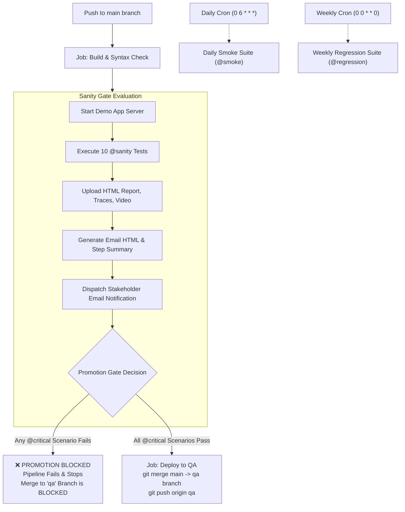

hi # 🚀 QA Sanity, Daily Smoke & Weekly Regression CI/CD Automation Platform

[](.github/workflows/ci-cd.yml)
[](https://playwright.dev/)
[](https://nodejs.org/)
[](#-how-the-promotion-gate-works)

A production-ready demonstration repository integrating **Playwright automated testing** with a modern **GitHub Actions CI/CD pipeline**. It automatically triggers sanity checks upon QA deployment, enforces an automated **promotion gate** that blocks downstream environments on critical failures, dispatches rich **email notifications** (pass/fail/blocked), and runs **daily smoke tests** and **weekly regression suites** via cron schedules.

---

## 📌 Executive Summary

### The Challenge
Previously, QA sanity scenarios were executed manually after deployments. This led to:
- High manual effort and delayed deployment verification.
- Human bottlenecks preventing continuous delivery.
- Risk of defective builds being prematurely promoted to Staging and Production.

### The Solution
This standalone demo repository demonstrates the complete, automated DevOps solution before merging into production repositories:
1. **Event-Driven QA Sanity (`push` to `main`)**: Triggers immediately following successful deployment to QA.
2. **Scheduled Cadences via Cron**:
   - **Daily Smoke Suite (1-day interval)**: Verifies overall system health and core journeys across environments (`cron: '0 6 * * *'`).
   - **Weekly Regression Suite (1-week interval)**: Executes comprehensive functional tests, API schema validations, and edge cases every Sunday (`cron: '0 0 * * 0'`).
3. **Automated Promotion Gate**: If any test tagged `@critical` fails (or if the application is unreachable), the pipeline immediately marks the gate as `BLOCKED`, halts pipeline execution with an error, and blocks deployment to Staging/Production.
4. **Actionable Email & Job Reporting**: Produces an executive-ready HTML email and GitHub Step Summary with pass/fail counts, duration, and detailed stack traces for failing scenarios. Full Playwright HTML reports, screenshots, traces, and video recordings are archived for 14 days.
5. **Self-Contained Demo Application**: Built-in modern e-commerce web application (`src/server.js`) providing real endpoints (`/`, `/api/health`, `/login`, `/products`, `/cart`, `/checkout`, `/orders`, `/dashboard`, `/profile`) and failure simulation toggles for live demonstration.

---

## 🏗️ Architecture & Pipeline Workflow



---

## ⏱️ Three-Tier Test Suite Strategy

| Suite | Trigger Mechanism | Cron Schedule | Target Duration | Tag Filter | Gate Impact |
|---|---|---|---|---|---|
| **Sanity** | Push to `main` (Post-Deploy) & `workflow_dispatch` | Event-driven (Immediate) | `< 2-3 mins` | `--grep @sanity` | **Hard Block**: Any `@critical` failure blocks promotion |
| **Smoke** | Daily Cron & `workflow_dispatch` | `0 6 * * *` (Every 24h / 1 day) | `< 5 mins` | `--grep @smoke` | **Daily Health Audit**: Alerts on regression |
| **Regression** | Weekly Cron & `workflow_dispatch` | `0 0 * * 0` (Every 7 days / Sun) | `< 15 mins` | `--grep @regression` | **Deep Audit**: End-to-end purchasing & security validation |

### Test Scenarios Breakdown

#### 1. Sanity Suite (`tests/sanity/sanity.spec.ts`)
- `Home page loads without server errors @sanity @critical`
- `Health endpoint is OK @sanity @critical`
- `User can log in @sanity @critical`
- `Search returns results @sanity @critical`
- `Add item to cart @sanity @critical`
- `Checkout page opens @sanity @critical`
- `Order history loads @sanity`
- `Profile page loads @sanity`
- `Static assets served @sanity`
- `No console errors on home page @sanity`

#### 2. Smoke Suite (`tests/smoke/smoke.spec.ts`)
- `System health and sub-services status check @smoke @critical`
- `User authentication and session cookie persistence @smoke @critical`
- `Navigation across primary headers and routes @smoke`
- `Product catalog display and search query filtering @smoke`
- `Cart addition, quantity increment, and price calculation @smoke`
- `Profile and user preferences view @smoke`
- `Responsive viewport layout on mobile and desktop @smoke`
- `API 404 and error response format verification @smoke`

#### 3. Regression Suite (`tests/regression/regression.spec.ts`)
- `Complete purchase journey: search, add to cart, checkout, and order receipt @regression @critical`
- `Authentication boundary checks: invalid credentials reject @regression`
- `Session logout and state termination @regression`
- `Form validation on checkout required fields @regression`
- `Dashboard metrics data integrity and service list @regression`
- `API contract schema validation for health and products @regression`
- `Security headers verification @regression`
- `Page response time benchmark @regression`

---

## 🛡️ How the Promotion Gate Works

1. **Tagging Convention**:
   - Tag all post-deploy sanity tests with `@sanity`.
   - Tag essential, non-negotiable checks with `@sanity @critical`.
2. **Blocking Logic**:
   - **BLOCKED**: If any test tagged `@critical` fails, or if the suite crashes/app is unreachable (producing no results), the job exits with code `1`.
   - Downstream deployment jobs (`deploy-staging` and `deploy-prod`) define `needs: [sanity-qa]` and will **never start**.
   - The email subject reads: `❌ [Sanity FAIL] QA — 9/10 passed, 1 failed (abcdef1) — PROMOTION BLOCKED`.
3. **Non-Blocking Warnings**:
   - Tests tagged solely `@sanity` (without `@critical`) emit a `::warning::` if they fail, but do not block promotion by default.
   - To enforce a zero-tolerance policy where **any** failure blocks promotion, set the repository variable `SANITY_GATE_MODE` = `any`.
4. **Resolution**:
   - Review the failure in the email or GitHub Actions summary.
   - Download the Playwright trace and screenshots from artifacts.
   - Push a fix to branch or click **Re-run failed jobs** in GitHub Actions.

---

## 📁 Repository Directory Structure

```
├── .github/
│   └── workflows/
│       ├── ci-cd.yml                   # Main CI/CD Pipeline (Build -> QA -> Sanity -> Staging -> Prod)
│       ├── post-deploy-sanity.yml      # Reusable Test Runner & Gate Workflow
│       ├── smoke-tests.yml             # Daily Cron Smoke Suite (1 day interval)
│       ├── regression-tests.yml        # Weekly Cron Regression Suite (1 week interval)
│       ├── deploy.example.yml          # Example showing how to hook into existing deploy scripts
│       └── qa-sanity-on-deploy.yml     # Zero-touch trigger using workflow_run
├── src/
│   ├── server.js                       # Express demo app (Health, Auth, Catalog, Cart, Checkout, Dashboard)
│   └── public/
│       ├── css/styles.css              # Modern UI styling
│       └── js/app.js                   # Client interactivity & cart handling
├── tests/
│   ├── sanity/
│   │   └── sanity.spec.ts              # 10 Sanity scenarios (@sanity, @critical)
│   ├── smoke/
│   │   └── smoke.spec.ts               # 8 Daily smoke scenarios (@smoke)
│   └── regression/
│       └── regression.spec.ts          # 8 Weekly regression scenarios (@regression)
├── scripts/
│   ├── build-report.mjs                # Parses Playwright JSON -> generates email HTML & step summary
│   └── test-gate-demo.mjs              # Interactive CLI simulation for PASS and BLOCKED gate demos
├── docs/
│   ├── design/                         # Architecture design document (Word specification)
│   └── samples/                        # Sample PASS & FAIL email artifacts and screenshots
├── playwright.config.ts                # Playwright configuration (HTML/JSON reporters, retry, webServer)
├── package.json                        # Scripts & dependencies
└── README.md                           # Documentation & Manager Review Guide
```

---

## ⚙️ Configuration & Setup Guide

### 1. Environments Setup
Under **GitHub Repository → Settings → Environments**, create:
- `qa`
- `staging`
- `prod` (Configure *Required Reviewers* for manual gate approvals if desired)

In each environment, set the variable:
- `BASE_URL`: The target URL (e.g. `https://qa.shopnova.internal`). If left blank or targeting localhost, the pipeline automatically starts the built-in demo web server.

### 2. Secrets & Variables Configuration
Under **Settings → Secrets and variables → Actions**:

#### Repository Secrets
| Secret | Description | Example |
|---|---|---|
| `SMTP_SERVER` | SMTP host for email dispatch | `smtp.gmail.com` or `smtp.office365.com` |
| `SMTP_PORT` | SMTP port (465 for SSL, 587 for TLS) | `587` |
| `SMTP_USERNAME` | SMTP account / service username | `qa-automation@company.com` |
| `SMTP_PASSWORD` | App password / API key | `••••••••••••` |
| `SANITY_USER` | *(Optional)* Demo auth user | `testuser` |
| `SANITY_PASSWORD` | *(Optional)* Demo auth password | `Password123!` |

> [!NOTE]
> **Zero-Friction Demo Guarantee**: If SMTP secrets are not yet configured, the workflow does not crash. It automatically logs an informational step notice and outputs the complete report to the **GitHub Actions Job Summary** and run artifacts.

#### Repository Variables
| Variable | Description | Default |
|---|---|---|
| `SANITY_EMAIL_RECIPIENTS` | Comma-separated list of email recipients | `qa-team@company.com, devops@company.com` |
| `SANITY_EMAIL_FROM` | Sender address | Same as `SMTP_USERNAME` |
| `SANITY_RUNNER` | Runner label (e.g. self-hosted runner behind VPN) | `ubuntu-latest` |
| `SANITY_GATE_MODE` | Gate blocking criteria (`critical` or `any`) | `critical` |
| `HEALTH_PATH` | Health endpoint path | `/api/health` |

---

## 💻 Local Quickstart & Manager Demo Walkthrough

### 1. Installation
Clone this repository and install dependencies:
```bash
git clone https://github.com/deepak4566/Sanity-automation.git
cd Sanity-automation
npm install
npx playwright install chromium
```

### 2. Run All Suites Locally
Playwright's `webServer` automatically starts the demo application on `http://localhost:3000`:
```bash
# Run the 10 Sanity tests
npm run test:sanity

# Run the 8 Daily Smoke tests
npm run test:smoke

# Run the 8 Weekly Regression tests
npm run test:regression
```

### 3. Interactive Manager Demo (Simulating Gate PASS & Gate BLOCKED)

This repository includes a dedicated simulation tool to demonstrate how the promotion gate functions during a failure:

#### A. Demonstrate Passing Promotion Gate
```bash
npm run test:gate:pass
```
*Result:* All 10 tests pass. Output displays `status=PASS`, `gate=OPEN`. In CI/CD, deployment proceeds to Staging.

#### B. Demonstrate Failing Promotion Gate (Blocked Promotion)
```bash
npm run test:gate:fail
```
*Result:* Simulates a failure in the `@critical` checkout scenario. 9 tests pass, 1 critical test fails. Output displays `status=FAIL`, `gate=BLOCKED`. In CI/CD, the workflow fails immediately, blocking promotion to Staging and sending an urgent alert email.

---

## 📧 Email Notification Samples

The generated emails use clean, responsive HTML compatible with Outlook, Apple Mail, and Gmail.

### PASS Email
Subject: `✅ [Sanity PASS] QA — 10/10 passed (abcdef1)`
- **Header:** Green status banner.
- **Promotion Gate:** `ALLOWED — safe to promote to the next environment.`
- **Details Table:** Environment, target URL, commit, trigger actor, duration.
- **Results:** Full list of executed tests with execution times.

### FAIL Email (Promotion Blocked)
Subject: `❌ [Sanity FAIL] QA — 9/10 passed, 1 failed (abcdef1) — PROMOTION BLOCKED`
- **Header:** Red alert banner.
- **Promotion Gate:** `BLOCKED — 1 critical test(s) failed; review before promoting to the next environment.`
- **Failed Tests Section:** Highlights critical failures with error messages, locators, and file paths.
- **Direct Link:** Button linking to the GitHub Actions run to inspect traces and video recordings.

*(Inspect full HTML samples and screenshots under [`docs/samples/`](docs/samples/)).*

---

## 📋 Implementation Checklist for Manager Review

- [x] **Repository Restructured**: Clean root directory structure ready for immediate upload to GitHub.
- [x] **Self-Contained Demo Application**: Working web server with real UI and REST endpoints.
- [x] **Sanity Suite (On Push)**: 10 automated post-deploy checks (`tests/sanity/sanity.spec.ts`).
- [x] **Daily Smoke Suite (1-Day Cadence)**: Automated daily cron `0 6 * * *` (`tests/smoke/smoke.spec.ts`).
- [x] **Weekly Regression Suite (1-Week Cadence)**: Automated weekly cron `0 0 * * 0` (`tests/regression/regression.spec.ts`).
- [x] **Promotion Gate Enforced**: Blocks downstream deployments (`deploy-staging`, `deploy-prod`) on `@critical` failures.
- [x] **Comprehensive Reporting**: Playwright HTML report + traces, GitHub Job Step Summary, and formatted HTML email report.
- [x] **Non-Crashing Fallback**: Runs smoothly whether SMTP secrets are configured or in local demo mode.
- [x] **Simulation CLI Tools**: `npm run test:gate:pass` and `npm run test:gate:fail` for live manager presentations.
